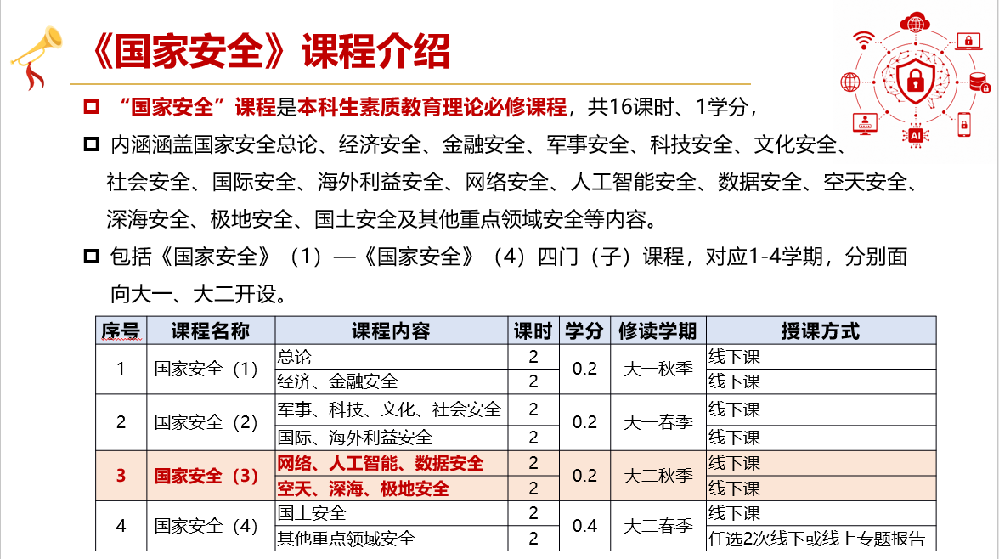
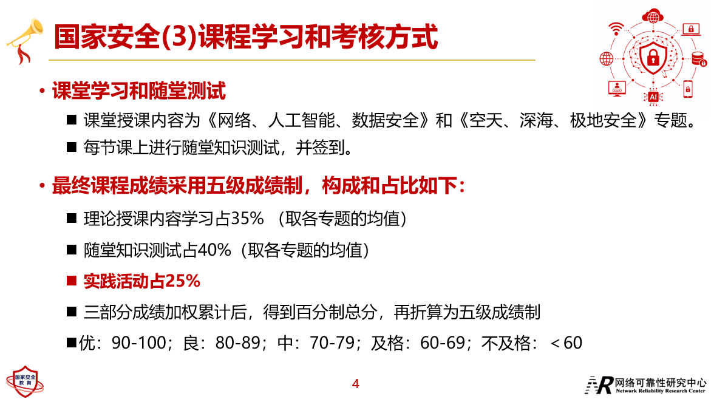
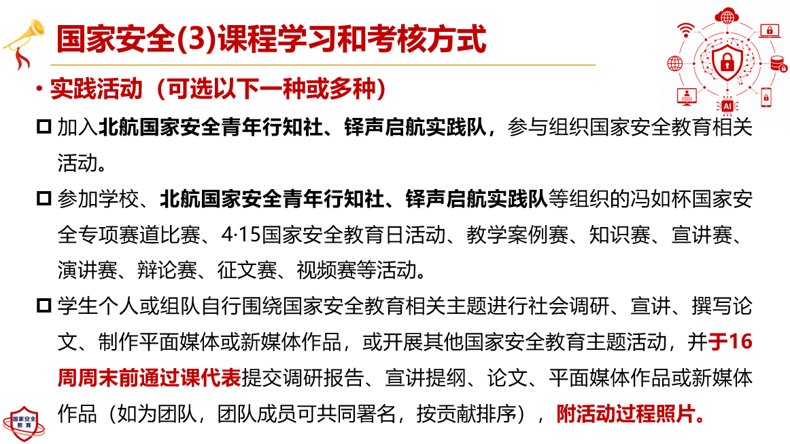

<!-- ROBOT:WEEKLY:START 机器人管理区：每周作业只保留最新一周，旧周会被自动替换掉 -->

# 📅 26秋 第 11 周

📌 第13周基础医学实验调至本周六下午 下周一无生物力学理论课

| 科目 | 作业内容 | 截止时间 |
|------|----------|----------|
| 概率统计B | 习题4.3的：1、3、4、5、6、7、8、10；习题5.1：1、3、5、6、7 | 11.24 23:59 |
| 普通物理学 | 习题12-27、12-29、12-30、12-32、12-33、12-36、12-38、12-39 | 以老师通知为准 |
| 基物实验 | 第十一周实验报告、第十二周预习报告 | 第十二周课前 |
| 基础医学实验 | 第十二周实验报告 | 第十三周课前 |
| 生物力学 | 第一次实验报告 | 以老师通知为准 |
| 电路分析 | 第十周实验报告 | 第十二周课前 |

---

<!-- ROBOT:WEEKLY:END -->

# 📌 长期作业

## 国安作业提交

请大家在 十六周周末（12.27）22:00 前上传国安作业到网盘。
https://bhpan-443.e1.buaa.edu.cn/link/AAB21AC286D37F4241B31F7058CE9AE2F3
提取码：4au5

