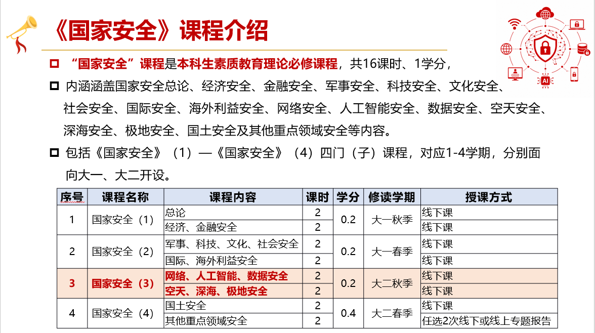
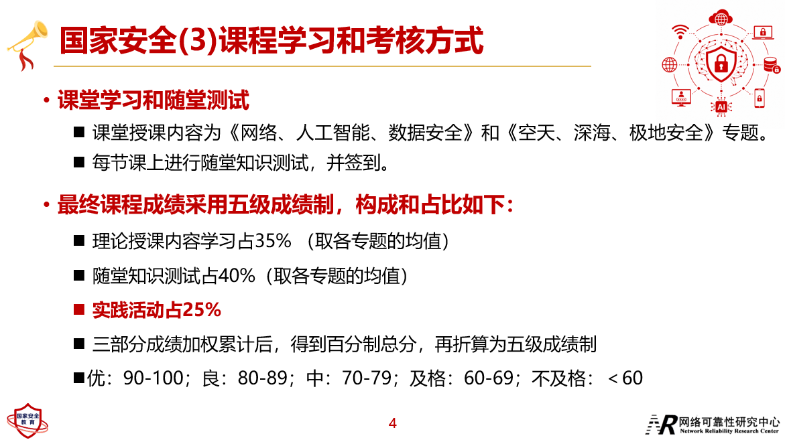
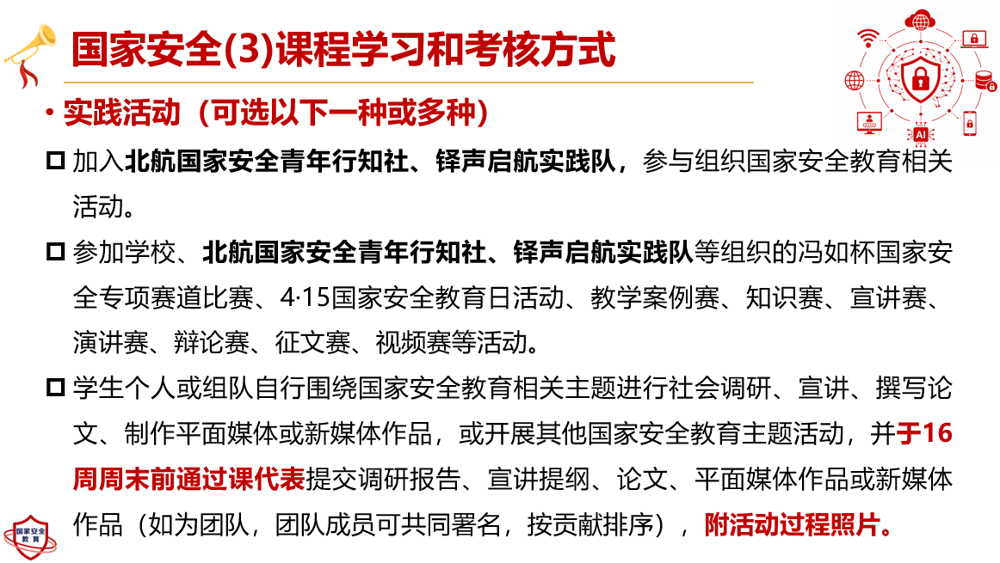

<!-- ROBOT:WEEKLY:START 机器人管理区：每周作业只保留最新一周，旧周会被自动替换掉 -->

# 📅 26秋 第 10 周

| 科目 | 作业内容 | 截止时间 |
|------|----------|----------|
| 普通物理学 | 习题12-14、12-15、12-17、12-19、12-20、12-23、12-25、12-26 | 以通知为准 |
| 基础医学实验 | 第十周实验报告 | 第十一周课前 |
| 电路分析 | 第十周实验报告 | 第十二周课前 |
| 基物实验 | 第十周实验报告、第十一周预习报告 | 第十一周课前 |
| 概率统计B |  | 以老师通知为准 |

---

<!-- ROBOT:WEEKLY:END -->

# 📌 长期作业

## 国安作业提交

请大家在 十六周周末（12.27）22:00 前上传国安作业到网盘。
https://bhpan-443.e1.buaa.edu.cn/link/AAB21AC286D37F4241B31F7058CE9AE2F3
提取码：4au5

